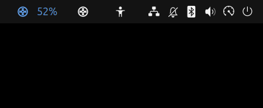
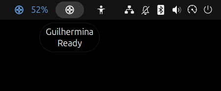
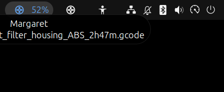

# Klipper Notifier

GNOME Shell extension that puts one top bar icon per [Klipper](https://www.klipper3d.org/) printer, live from [Moonraker](https://github.com/Arksine/moonraker).

<p>
  
  
  
</p>

## Features

- One filament spool icon per printer, tinted by state:

  | State | Icon |
  |---|---|
  | Ready | panel color |
  | Printing | blue, with progress % |
  | Paused | amber, with progress % |
  | Error | red |
  | Unreachable | grey |

- Hover shows the printer name and its state: progress and file while printing, the Klipper error message on error.
- Left click opens the printer's URL in the browser; right click opens Settings.
- With no printer configured, a spool **+** icon opens Settings to add one.
- Live WebSocket connection per printer, reconnecting on its own.

## Requirements

- GNOME Shell 50
- Moonraker reachable on the LAN without an API key

## Install

From [extensions.gnome.org](https://extensions.gnome.org/), or from source:

```sh
git clone https://github.com/kkobold/klipper-notifier.git
cd klipper-notifier
make install
```

Log out and back in (Wayland can't reload the shell), then enable **Klipper Notifier** in the Extensions app.

## Usage

Open the extension settings (or click the spool **+** icon) and add a printer with a name and its URL, e.g. `192.168.1.50` or `192.168.1.50:7125`. The same URL is used for the Moonraker connection and for the browser on left click, so the bare host behind Mainsail/Fluidd's nginx is usually the best choice.

## License

[MIT](LICENSE)
